# Milepost API on EC2, across two Availability Zones

## What we're trying to do

**Run one API on two virtual machines that sit in two different Availability Zones, inside a network built piece by piece.**

- **Starts from:** the Milepost API in `app/`, a FastAPI service with two models: a used-car price estimator (XGBoost) and a loan pre-check (scikit-learn).
- **Ends with:** the same Docker image running on two EC2 instances:
  - `milepost-ec2-a` in `us-west-2a`
  - `milepost-ec2-b` in `us-west-2b`
- **Every answer says which copy served it:** the Availability Zone and the instance ID.
- **The service offers:**

| Route | What it does |
|---|---|
| `GET /` | Service name and `served_by` (AZ + instance ID) |
| `GET /health` | Scores a fixed test car and buyer to prove both models load; also returns `served_by` |
| `POST /predict/price` | Resale price in lakhs for one car |
| `POST /predict/price/batch` | Prices for up to 1,000 cars in one call |
| `POST /predict/loan` | Loan decision, probability, and the threshold applied |
| `GET /docs` | Interactive page for trying every route from the browser |

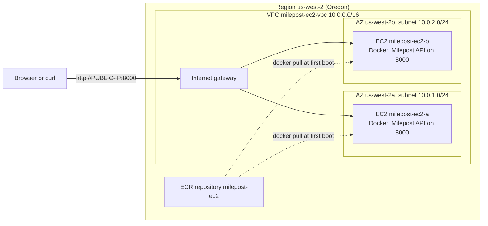

## How we're doing it

**Build each network piece in the AWS console, one at a time, then run the container on two EC2 instances, one per AZ.**

| Step | The problem | What fixes it |
|---|---|---|
| VPC | You need your own private network in AWS | A VPC with the range `10.0.0.0/16` |
| Two subnets | One data centre can fail | One subnet in `us-west-2a`, one in `us-west-2b` |
| Internet gateway + route table | A new subnet cannot reach the internet, and nothing outside can reach it | `0.0.0.0/0 → internet gateway` on both subnets |
| Security group | An instance accepts no inbound traffic by default | Allow port 8000 from your own IP only |
| ECR | The instances need somewhere to pull the image from | A private repository, `milepost-ec2` |
| IAM role | The instances need permission to pull, without access keys copied onto them | `MilepostEc2Role` with read-only ECR access |
| EC2 + user data | Someone has to install Docker and start the container | A boot script that does it on first start |
| Stop-one experiment | What really happens when one machine stops? | Observe it: the other keeps serving, nothing replaces the stopped one |
| Load balancer (written out) | Two addresses, and no automatic failover | One DNS name in front of both, with health checks |

- Everything happens in **US West (Oregon), `us-west-2`**.
- **Steps 1–11 and the cleanup (step 14) were run as shown;** the outputs quoted in them are real.
- **The load balancer section (step 12) is written out, not run.** Its screenshots show the console forms filled in, but stop before **Create**, because the account they were taken in has no Elastic Load Balancing permission.

## How to go through this folder

### What you need

| For | You need |
|---|---|
| All steps | An AWS account that can use EC2, VPC, ECR and IAM roles in `us-west-2` |
| Pushing the image (step 7) | AWS CLI v2, configured with `aws configure` (region `us-west-2`), and Docker Desktop |
| The load balancer (step 12) | Elastic Load Balancing permission in the same account |

### The route

1. **Optional:** run the API on your laptop (step 0).
2. Choose the Region and look at its AZs (step 1).
3. Build the network: VPC, subnets, internet gateway, route table (steps 2–5).
4. Create the security group, the ECR repository and the IAM role, and push the image (steps 6–8).
5. Launch the two instances (step 9).
6. Call the API on both (step 10), then stop one and watch (step 11).
7. **If your account allows it:** put a load balancer in front (step 12).
8. Clean up (step 14).

- Commands are written for **bash**. On Windows, run them in Git Bash or WSL.

### Files

| File | Used in | What it is |
|---|---|---|
| `app/fastapi_app.py` | Steps 0 and 7 | The API: two models and the routes above; also reports `served_by` |
| `app/requirements.txt` | Steps 0 and 7 | Pinned packages. `xgboost-cpu` is the CPU-only build of XGBoost 3.2.0: same `import xgboost`, without the NVIDIA libraries the regular Linux wheel pulls in |
| `app/Dockerfile` | Steps 0 and 7 | `python:3.12-slim` + packages + app + models; runs `uvicorn` on port 8000 as a non-root user |
| `app/artifacts/` | Steps 0 and 7 | `price_model.joblib`, `loan_model.joblib`, `model_meta.json` |
| `user_data.sh` | Step 9 | Boot script used by both instances |
| `screenshots/` | Every step | Console screenshots, numbered in step order |

## Words used here

| Word | Meaning |
|---|---|
| Region | A geographic area with its own copy of AWS, such as `us-west-2` (Oregon) |
| Availability Zone (AZ) | One or more data centres inside a Region, with separate power and networking. `us-west-2` has four: `us-west-2a` to `us-west-2d` |
| AZ ID | The physical zone behind an AZ name, such as `usw2-az1`. AZ names can map to different physical zones in different accounts; AZ IDs don't |
| VPC | Your private network inside a Region. It spans every AZ of that Region |
| CIDR | An address range written as `10.0.0.0/16`: the `/16` says how many leading bits are fixed |
| Subnet | A slice of the VPC's range that lives in exactly one AZ |
| Internet gateway | The VPC's door to the internet |
| Route table | Rules that say where traffic for each destination goes |
| Public subnet | A subnet whose route table sends `0.0.0.0/0` to an internet gateway |
| Security group | A firewall attached to each instance; inbound traffic is blocked unless a rule allows it |
| ECR | Elastic Container Registry: AWS's private Docker registry |
| IAM role | A set of permissions that a service (here EC2) can use without stored passwords or keys |
| Instance profile | The wrapper EC2 uses to attach a role to an instance; the console creates one with the role |
| User data | A script EC2 runs once, as root, on an instance's first boot |
| IMDSv2 | Instance metadata service: an address inside each instance (`169.254.169.254`) that tells it its own AZ, instance ID and temporary role credentials |
| Target group | The list of targets (instances, IPs) a load balancer may send requests to, plus their health check |
| ALB | Application Load Balancer: one HTTP entry point that spreads requests across healthy targets |

## 0. Run the API on your laptop (optional)

**The same image runs on your laptop and on EC2; only `served_by` changes.**

```bash
cd app
docker build --platform linux/amd64 -t milepost-ec2:v1 .
docker run --rm -p 8000:8000 milepost-ec2:v1
```

- Open `http://localhost:8000/docs` to see the API. `GET /` answers with `"availability_zone": "local"`.
- Stop the container with `Ctrl+C`.
- **Why `--platform linux/amd64`:** t3 instances have x86_64 CPUs. An image built on an Apple Silicon Mac is arm64 unless you ask otherwise, and it fails on EC2 with `exec format error`. Docker Desktop still runs the amd64 image on a Mac, just more slowly.

## 1. Region and Availability Zones

**`us-west-2` is a Region. `us-west-2a` to `us-west-2d` are its Availability Zones. You choose an AZ for every subnet; you never create one.**

- In the console header, choose **United States (Oregon)**.
- The AZ list appears when you create a subnet (step 3):

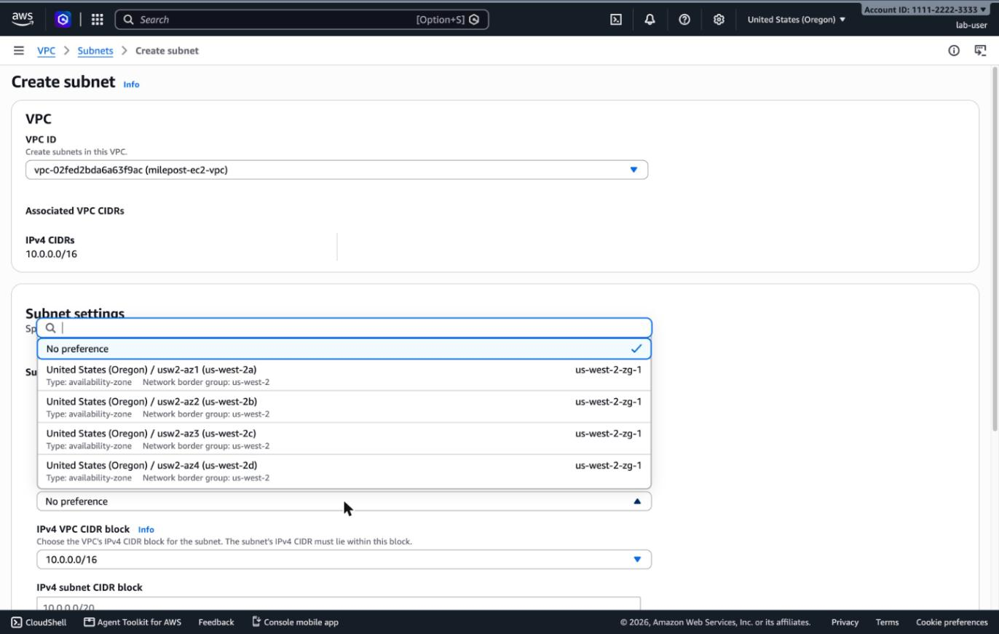

- Each entry shows the AZ name and its AZ ID, for example `usw2-az1 (us-west-2a)`.
- **Two AZs = two subnets.** A second subnet in the same AZ does not protect against that AZ failing.

## 2. Create the VPC

**A VPC is your private network in the Region. It spans every AZ; subnets come next.**

- **VPC → Your VPCs → Create VPC**

| Setting | Value |
|---|---|
| Resources to create | VPC only |
| Name tag | `milepost-ec2-vpc` |
| IPv4 CIDR | `10.0.0.0/16` |
| IPv6 CIDR block | No IPv6 CIDR block |
| Tenancy | Default |

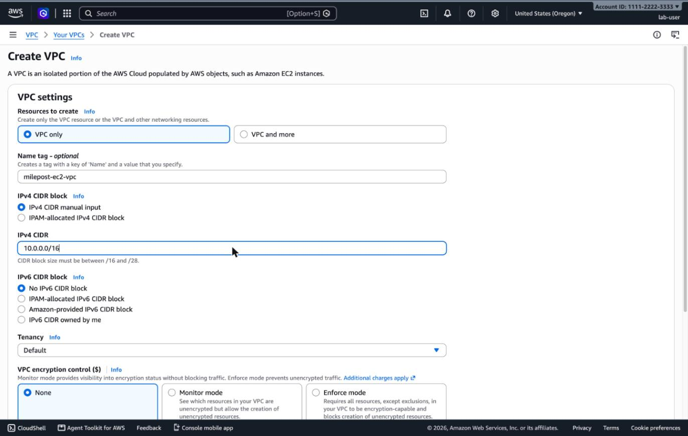

- `10.0.0.0/16` gives 65,536 private addresses to divide into subnets.

## 3. Create two subnets, one per AZ

**A subnet lives in exactly one AZ, so spreading over two AZs takes two subnets.**

- **VPC → Subnets → Create subnet**, choose VPC `milepost-ec2-vpc`, then use **Add new subnet** for the second one in the same form.

| Setting | Subnet 1 | Subnet 2 |
|---|---|---|
| Subnet name | `milepost-ec2-public-a` | `milepost-ec2-public-b` |
| Availability Zone | `us-west-2a` | `us-west-2b` |
| IPv4 subnet CIDR block | `10.0.1.0/24` | `10.0.2.0/24` |

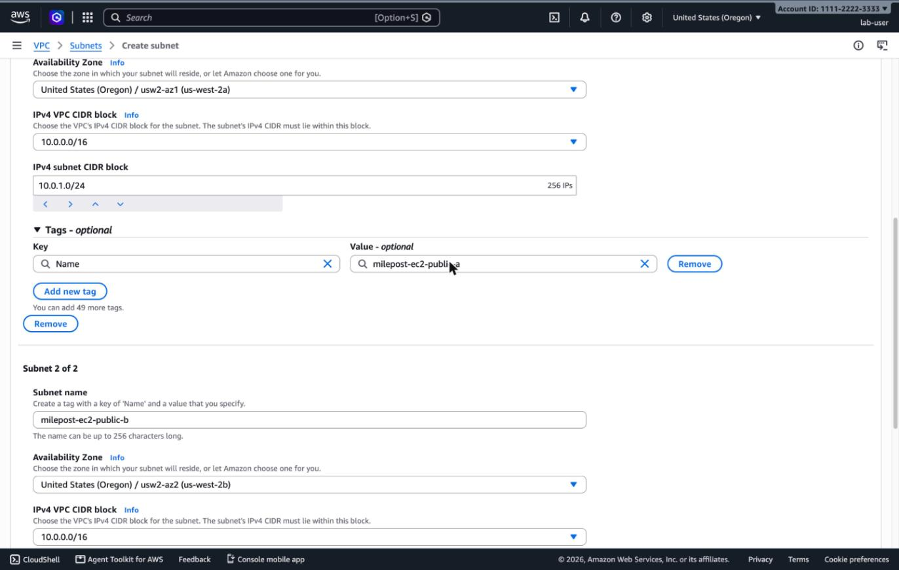

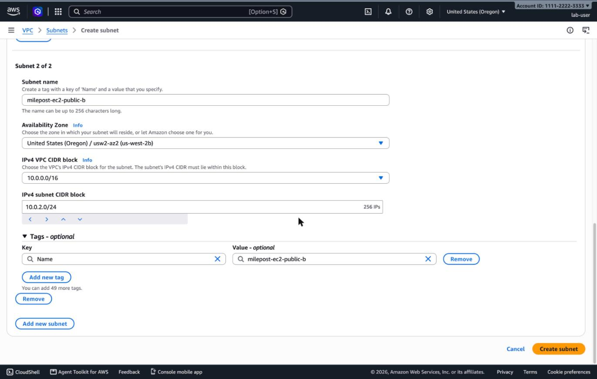

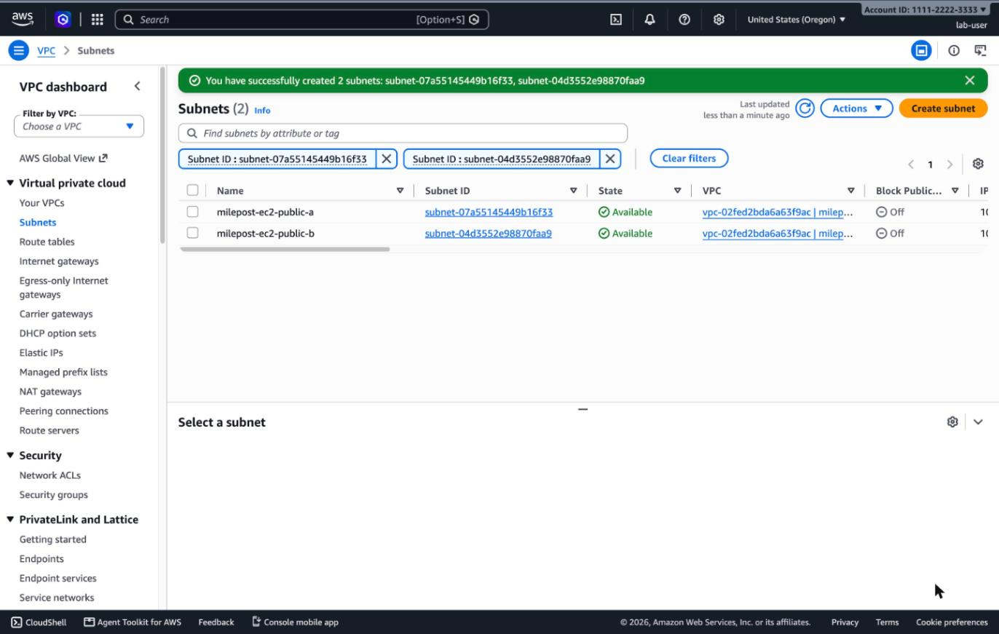

- **Subnet arithmetic:** a `/24` holds 256 addresses. AWS keeps 5 in every subnet (network address, VPC router, DNS, one reserved, broadcast), so **251** are usable. Every instance and load balancer node takes one.

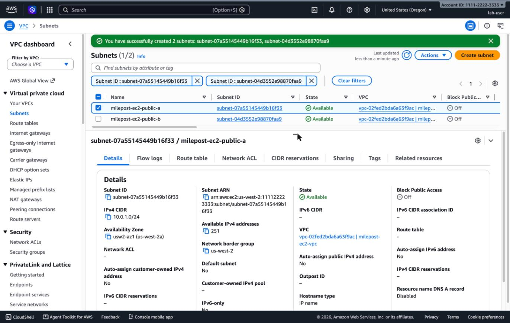

- For **each** subnet: select it → **Actions → Edit subnet settings** → tick **Enable auto-assign public IPv4 address** → **Save**.

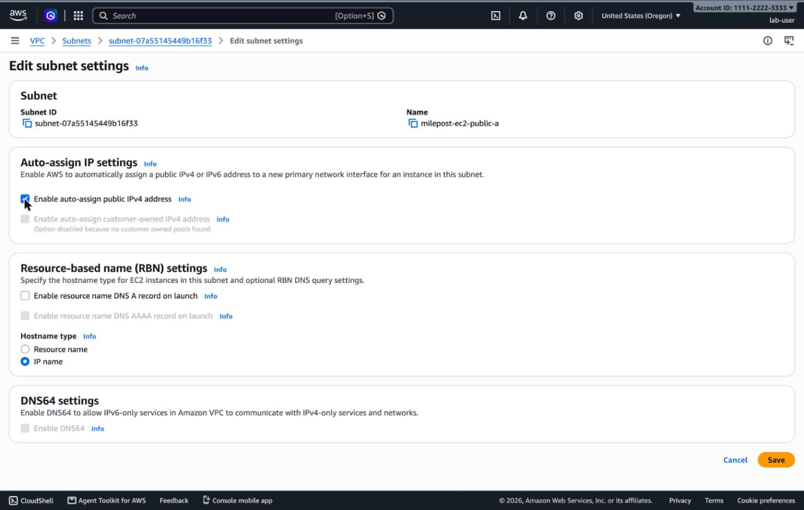

- **Why:** instances launched here get a public IPv4 address, so you can reach them and they can reach ECR.

## 4. Give the subnets a way to the internet

**A subnet is "public" only when its route table sends `0.0.0.0/0` to an internet gateway. A public IP alone is not enough.**

### 4.1 Internet gateway

- **VPC → Internet gateways → Create internet gateway**, name `milepost-ec2-igw`.

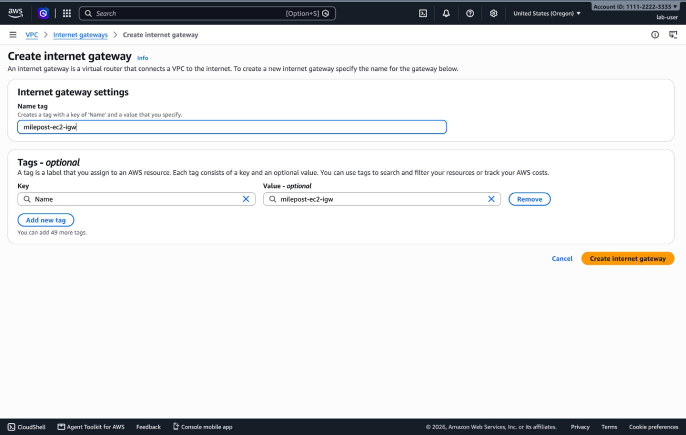

- A new gateway is **Detached**: it does nothing until it is attached to a VPC.

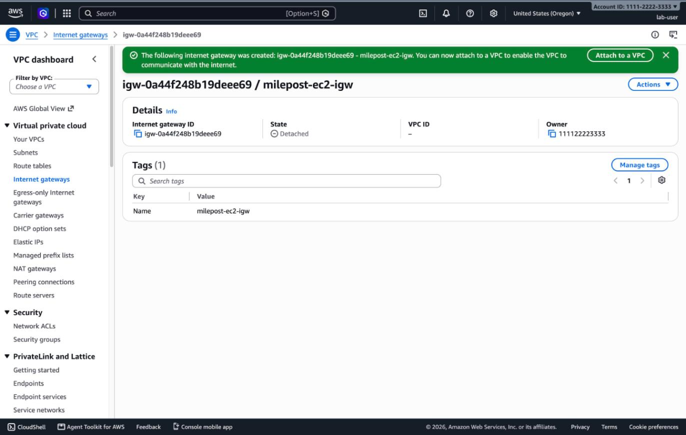

- **Actions → Attach to VPC** → `milepost-ec2-vpc` → **Attach internet gateway**.

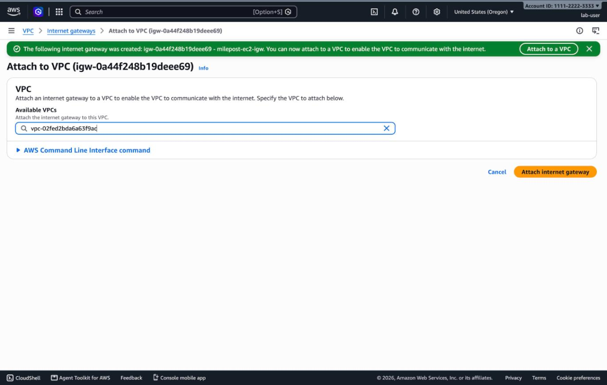

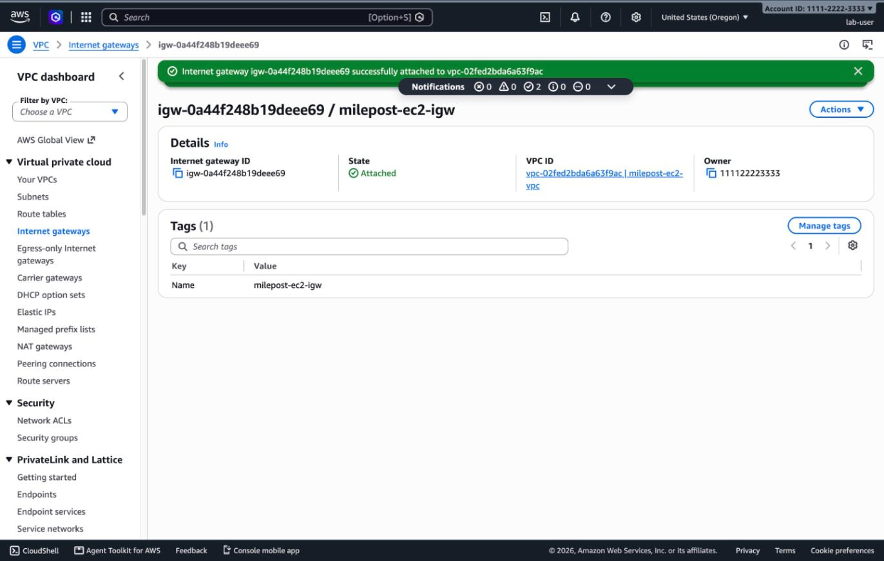

### 4.2 Route table

- **VPC → Route tables → Create route table**: name `milepost-ec2-public-rt`, VPC `milepost-ec2-vpc`.

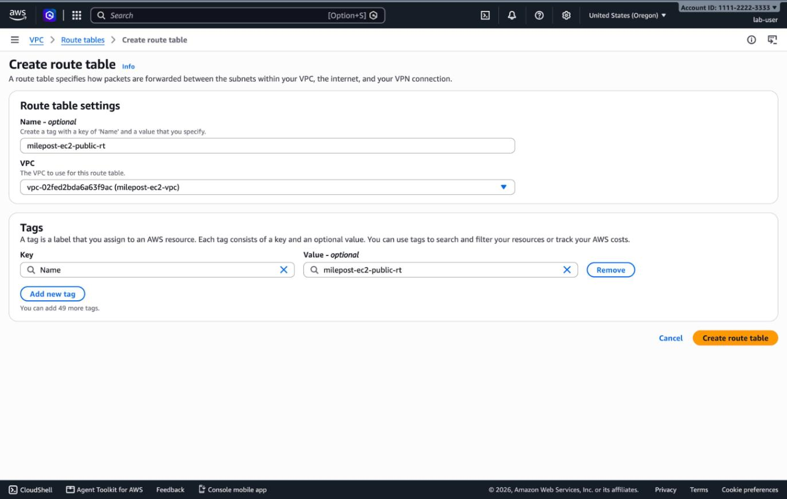

- A new route table has one route: `10.0.0.0/16 → local`, traffic between addresses inside the VPC.
- **Routes → Edit routes → Add route**: destination `0.0.0.0/0`, target **Internet Gateway** → `milepost-ec2-igw` → **Save changes**.

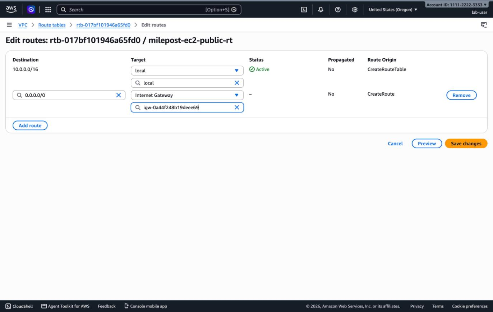

- **Subnet associations → Edit subnet associations** → tick both subnets → **Save associations**.

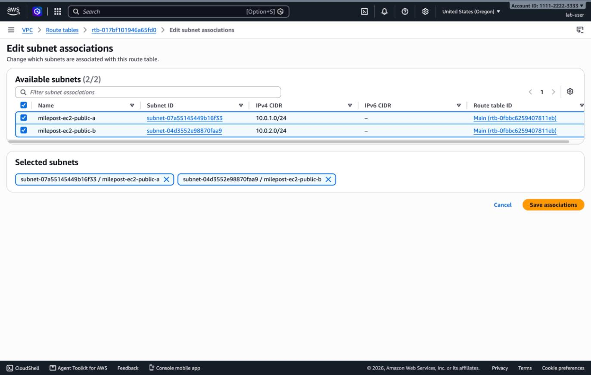

- Until you associate them, the subnets use the VPC's **main** route table, which has no internet route.

## 5. Check the network

**The resource map shows the whole chain on one screen.**

- **VPC → Your VPCs → `milepost-ec2-vpc` → Resource map**

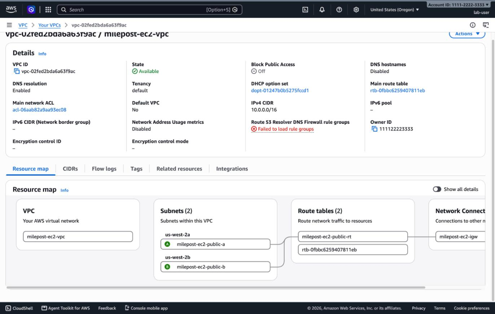

- Both subnets connect to `milepost-ec2-public-rt`, and it connects to `milepost-ec2-igw`.
- The second route table, `rtb-…`, is the VPC's main table. Nothing uses it now.

## 6. Security group for the instances

**A security group is a firewall around each instance. Nothing comes in until a rule allows it.**

- **EC2 → Security Groups → Create security group**

| Setting | Value |
|---|---|
| Security group name | `milepost-ec2-host-sg` |
| Description | `Milepost API on port 8000` |
| VPC | `milepost-ec2-vpc` |
| Inbound rule | Type **Custom TCP**, port **8000**, source type **My IP** |
| Outbound rule | Leave **All traffic** to `0.0.0.0/0` (the instances download Docker and the image) |

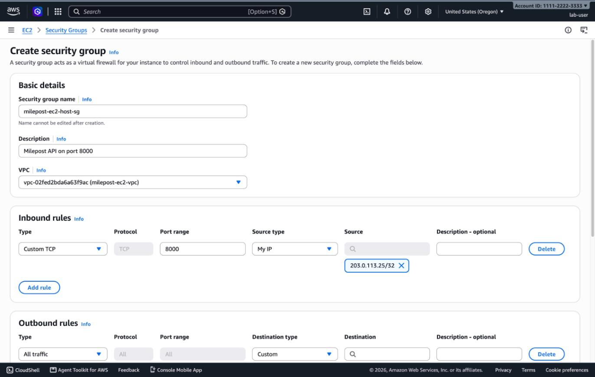

- **No SSH rule:** you never log in to these machines. If you need a shell, **Connect → Session Manager** works without port 22 (it uses the role's `AmazonSSMManagedInstanceCore` policy from step 8).
- **My IP** fills in the address your browser uses right now. Home connections change addresses; when yours does, calls time out (see step 13).

## 7. Put the image in ECR

**ECR is AWS's private Docker registry; the instances pull the image from it when they boot.**

- **ECR → Private registry → Repositories → Create repository**: name `milepost-ec2`, tag mutability **Mutable**, encryption **AES-256**.

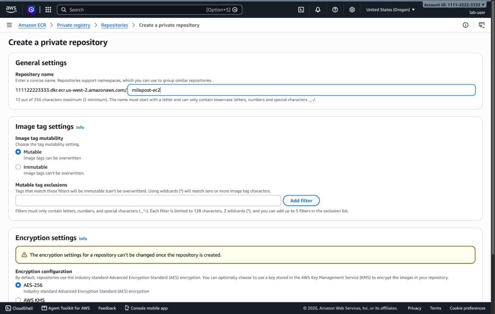

- Build and push from your laptop:

```bash
cd app
ACCOUNT_ID=$(aws sts get-caller-identity --query Account --output text)
REGISTRY=$ACCOUNT_ID.dkr.ecr.us-west-2.amazonaws.com

aws ecr get-login-password --region us-west-2 |
  docker login --username AWS --password-stdin $REGISTRY

docker build --platform linux/amd64 -t milepost-ec2:v1 .
docker tag milepost-ec2:v1 $REGISTRY/milepost-ec2:v1
docker push $REGISTRY/milepost-ec2:v1
```

- Expect `Login Succeeded`, then `v1: digest: sha256:… size: …`. The image is about 165 MB.
- The repository may also list one or two **untagged** entries next to `v1`. They are the image index and build attestation Docker pushes along with the image; leave them.

## 8. IAM role for the instances

**The instances prove who they are with a role, not with access keys copied onto them.**

- **IAM → Roles → Create role**
  1. **Trusted entity:** AWS service → **EC2** → use case **EC2** → Next.

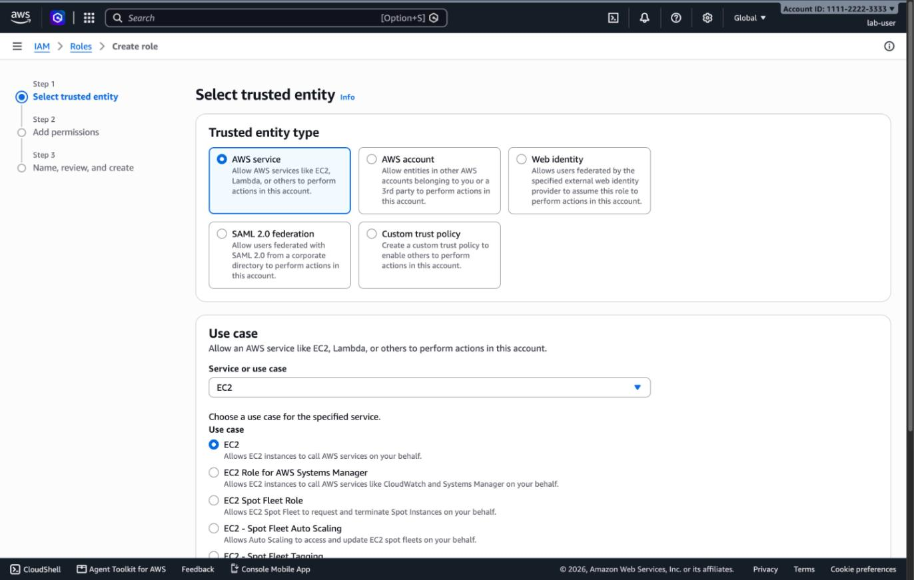

  2. **Permissions:** tick `AmazonEC2ContainerRegistryReadOnly` (pull from ECR) and `AmazonSSMManagedInstanceCore` (Session Manager shell) → Next.
  3. **Role name:** `MilepostEc2Role` → **Create role**.

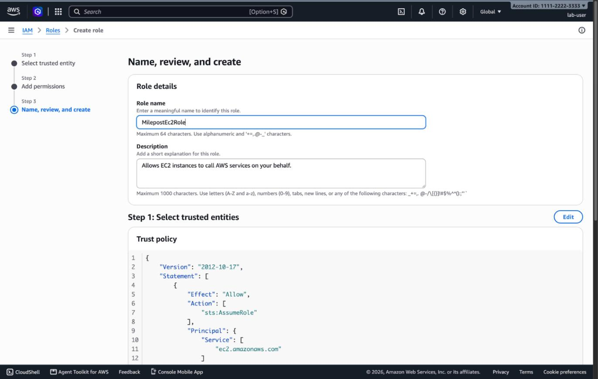

- The review screen shows both halves of a role:
  - **Trust policy:** who may use it, `ec2.amazonaws.com`;
  - **Permissions:** what it may do.

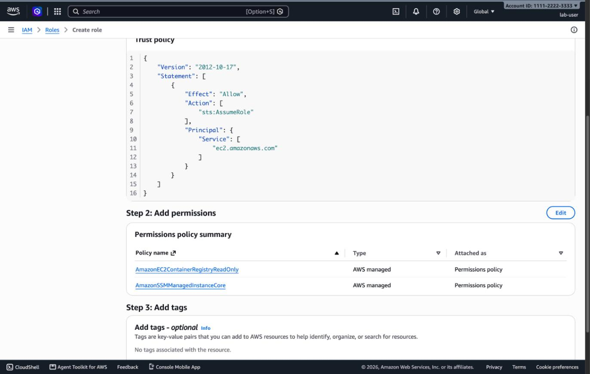

- Creating the role in the console also creates an **instance profile** with the same name. That is what EC2 attaches in the next step.

## 9. Launch the two instances

**Each instance installs Docker, pulls the image with its role, and starts the container on first boot, from `user_data.sh`.**

### 9.1 `milepost-ec2-a` in us-west-2a

- **EC2 → Instances → Launch instances**

| Setting | Value |
|---|---|
| Name | `milepost-ec2-a` |
| AMI | Amazon Linux 2023 (64-bit x86) |
| Instance type | `t3.micro` (2 vCPU, 1 GiB) |
| Key pair | Proceed without a key pair |
| Network settings → **Edit** → VPC | `milepost-ec2-vpc` |
| Subnet | `milepost-ec2-public-a` (us-west-2a) |
| Auto-assign public IP | Enable |
| Firewall | Select existing security group → `milepost-ec2-host-sg` |
| Storage | 8 GiB gp3 (default) |
| Advanced details → IAM instance profile | `MilepostEc2Role` |
| Advanced details → User data | Paste the whole of `user_data.sh` |

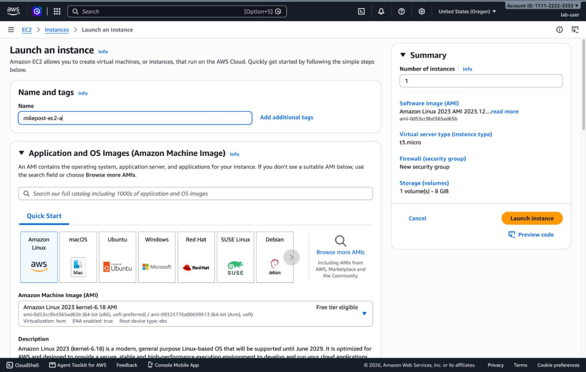

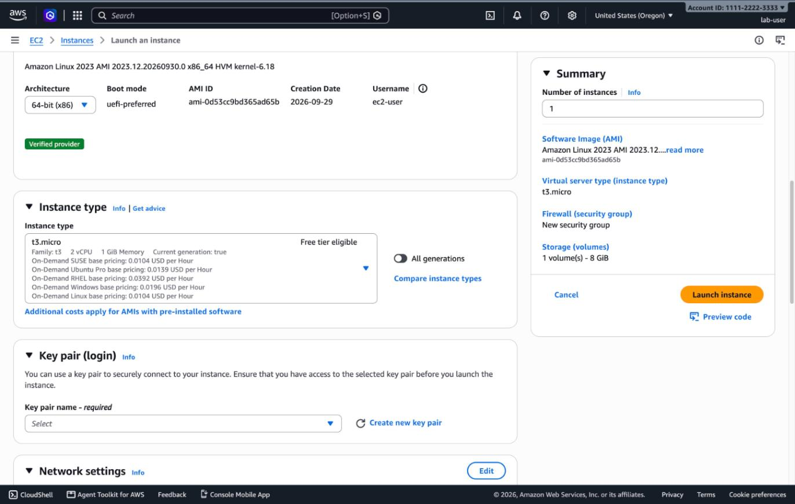

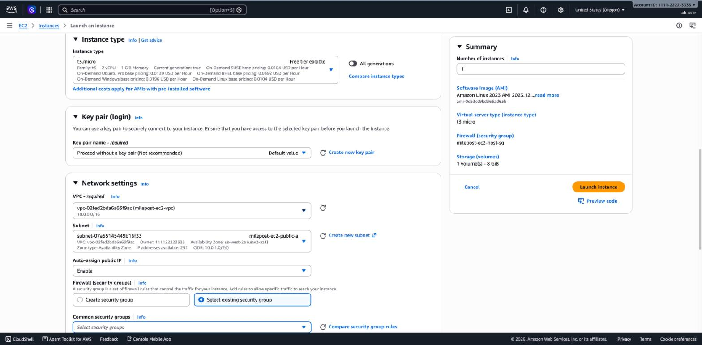

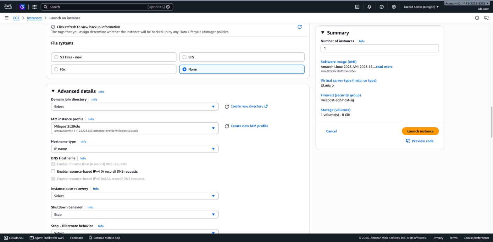

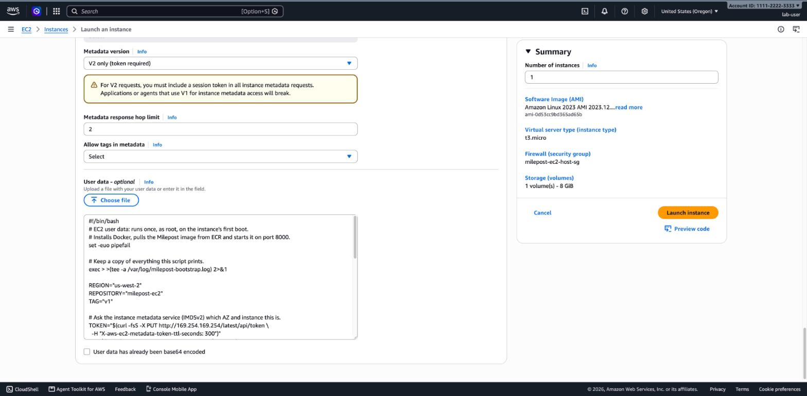

- **What `user_data.sh` does, in order:**
  1. Asks IMDSv2 for the instance's AZ and instance ID.
  2. Installs Docker and starts it on every boot.
  3. Looks up the account ID with the role (`aws sts get-caller-identity`) to build the registry address.
  4. Logs in to ECR with the role and pulls `milepost-ec2:v1`.
  5. Runs the container on port 8000 with `--restart unless-stopped`, passing the AZ and instance ID in as environment variables.
- The script contains **no account ID and no keys**, so the same file works in any account.
- Everything it prints goes to `/var/log/milepost-bootstrap.log` on the instance.

### 9.2 `milepost-ec2-b` in us-west-2b

- Select `milepost-ec2-a` → **Actions → Image and templates → Launch more like this**.
- Change three things:
  - **Name:** `milepost-ec2-b`
  - **Subnet:** `milepost-ec2-public-b` (us-west-2b)
  - **Key pair:** choose **Proceed without a key pair** again; this field resets to *Select*
- The AMI, instance type, security group, instance profile (shown as its full ARN) and user data are copied over.
- **Launch instance.**

### 9.3 Check

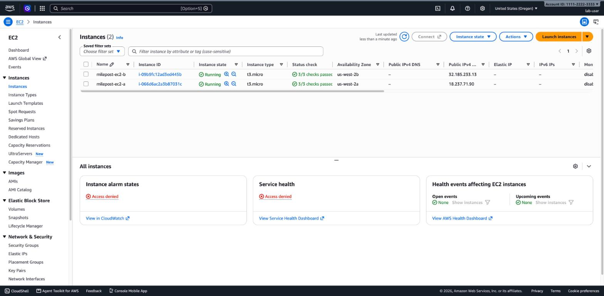

- Wait for **3/3 checks passed**. The container needs about 2–3 minutes after *Running*, while the user data installs Docker and pulls the image.

## 10. Call the API on both instances

**The same request, sent to each instance's public IP, shows which AZ answered.**

- Copy each instance's **Public IPv4 address** from the instance list.

```bash
curl http://<public-ip-of-a>:8000/
curl http://<public-ip-of-b>:8000/
```

```json
{"service":"Milepost API","docs":"/docs","served_by":{"availability_zone":"us-west-2a","instance_id":"i-066d6ac2a3b87031c"}}
{"service":"Milepost API","docs":"/docs","served_by":{"availability_zone":"us-west-2b","instance_id":"i-09b9fc12ad3ed445b"}}
```


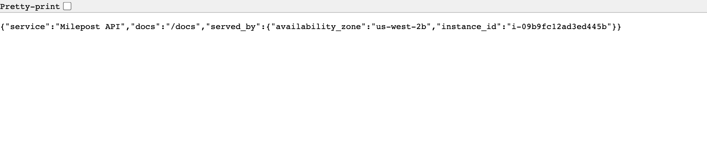

- **In the browser:** `http://<public-ip>:8000/docs` lists every route.

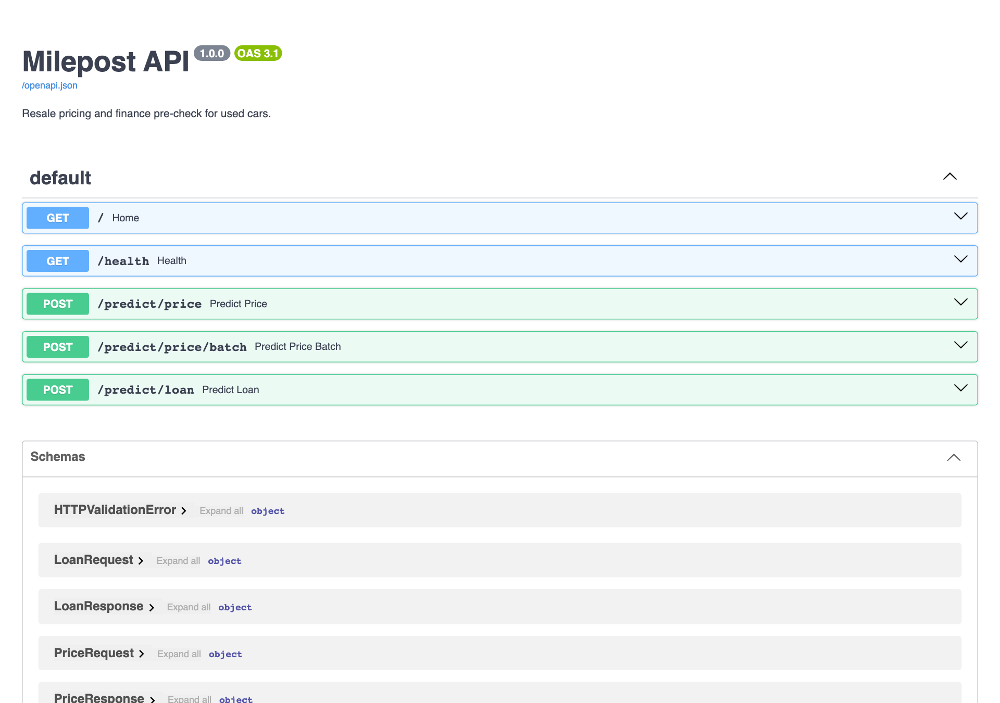

- **Predict a price:** open **POST /predict/price → Try it out**, paste the car below, then **Execute**.

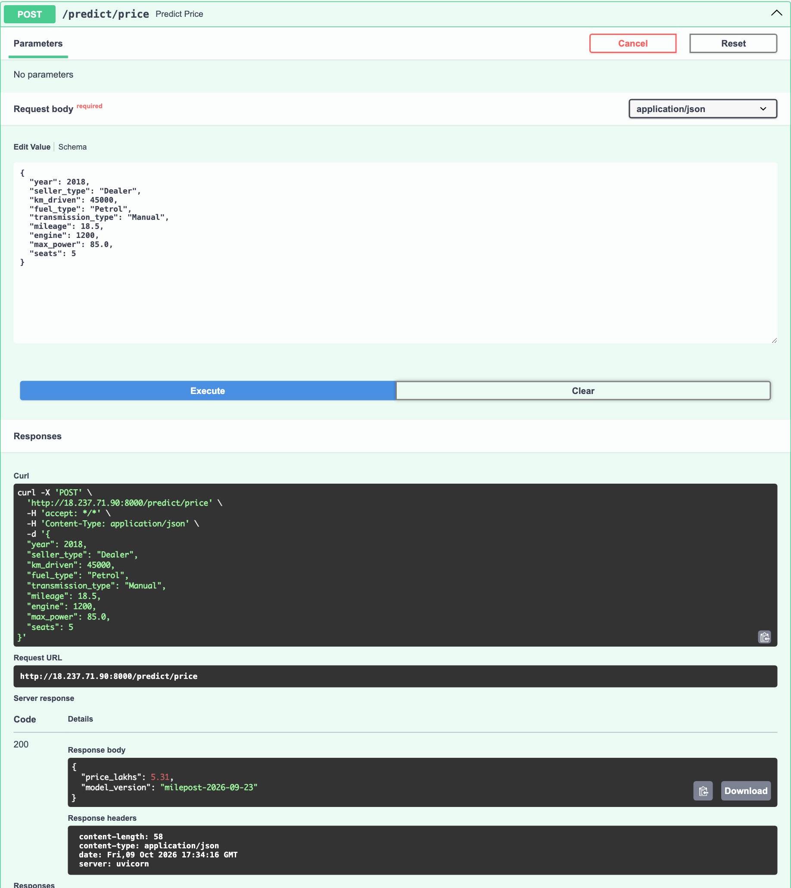

- **The same calls from a terminal:**

```bash
curl -X POST http://<public-ip>:8000/predict/price \
  -H 'Content-Type: application/json' \
  -d '{"year": 2018, "seller_type": "Dealer", "km_driven": 45000, "fuel_type": "Petrol",
       "transmission_type": "Manual", "mileage": 18.5, "engine": 1200, "max_power": 85.0, "seats": 5}'
# {"price_lakhs":5.31,"model_version":"milepost-2026-09-23"}

curl -X POST http://<public-ip>:8000/predict/loan \
  -H 'Content-Type: application/json' \
  -d '{"Gender": "Male", "Married": "No", "ApplicantIncome": 5000, "LoanAmount": 128,
       "Credit_History": "Cleared Debts"}'
# {"loan_approval_status":"Loan Rejected","probability":0.7448,"threshold_applied":0.8,"model_version":"milepost-2026-09-23"}
```

- A body with missing fields gets **422** before any model code runs.
- Some browsers show a "not secure" warning page for `http://` addresses. That's expected: this setup has no HTTPS. Continue past it, or use `curl`.

## 11. Experiment: stop one instance

**Two AZs give you two copies, but nothing here moves traffic or replaces a machine for you.**

- **Before you click, predict:**
  - What happens to requests sent to A?
  - Does AWS start a new instance?
  - Does B notice?
- Select `milepost-ec2-a` → **Instance state → Stop instance → Stop**.

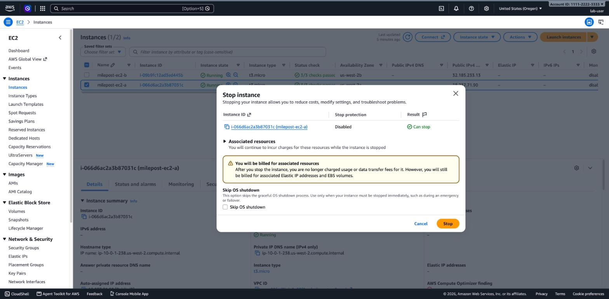

- **What happened:**

| Check | Result |
|---|---|
| `curl http://<old-ip-of-a>:8000/` | No answer: the call timed out |
| `curl http://<ip-of-b>:8000/` | Answered from `us-west-2b` as before |
| Instance list | A **Stopped**, with no public IP. B **Running**. No new instance appeared |

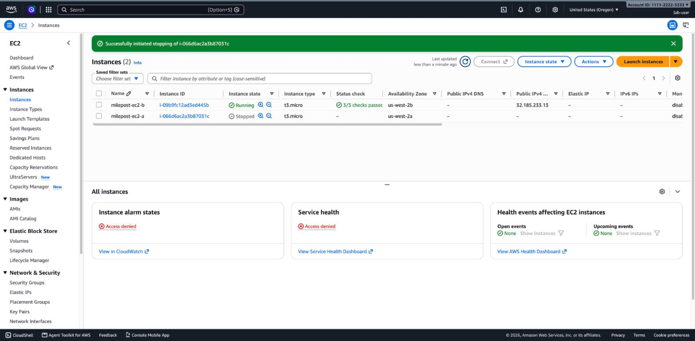

- **Start it again:** select `milepost-ec2-a` → **Instance state → Start instance**.

| | Before the stop | After the start |
|---|---|---|
| Instance ID | `i-066d6ac2a3b87031c` | same |
| Private IP | `10.0.1.238` | same |
| Public IP | `18.237.71.90` | **`35.89.82.138`**, a new one |
| `served_by` | `us-west-2a` | same; the container restarted on its own (`--restart unless-stopped`) |

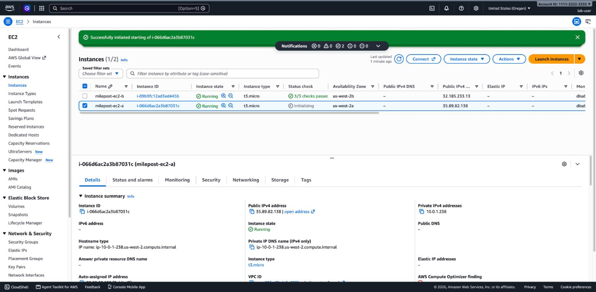

- **What this shows:**
  - Without a load balancer, every client has to know both addresses and switch by hand.
  - Nothing restarts or replaces a stopped instance.
  - Public IPs change on stop and start; private IPs and instance IDs don't.
  - User data runs only on the first boot; Docker's restart policy brought the container back.

## 12. Put a load balancer in front

**An Application Load Balancer gives one DNS name, spreads requests across healthy instances, and stops sending requests to an instance that fails its health check.**

- These steps were filled in on the console, but the screenshots stop before **Create**: the account they were taken in has no Elastic Load Balancing permission.

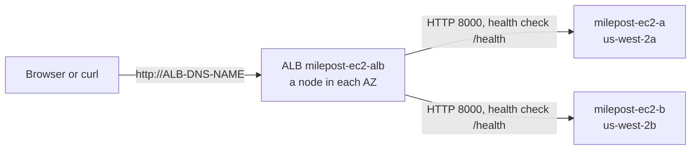

### 12.1 Security group for the load balancer

- **EC2 → Security Groups → Create**:
  - name `milepost-ec2-alb-sg`;
  - VPC `milepost-ec2-vpc`;
  - inbound **HTTP 80** from **Anywhere-IPv4**.

### 12.2 Target group

- **EC2 → Target groups → Create target group**

| Setting | Value |
|---|---|
| Target type | Instances |
| Target group name | `milepost-ec2-tg` |
| Protocol / port | HTTP / 8000 |
| VPC | `milepost-ec2-vpc` |
| Protocol version | HTTP1 |
| Health check path | `/health` |

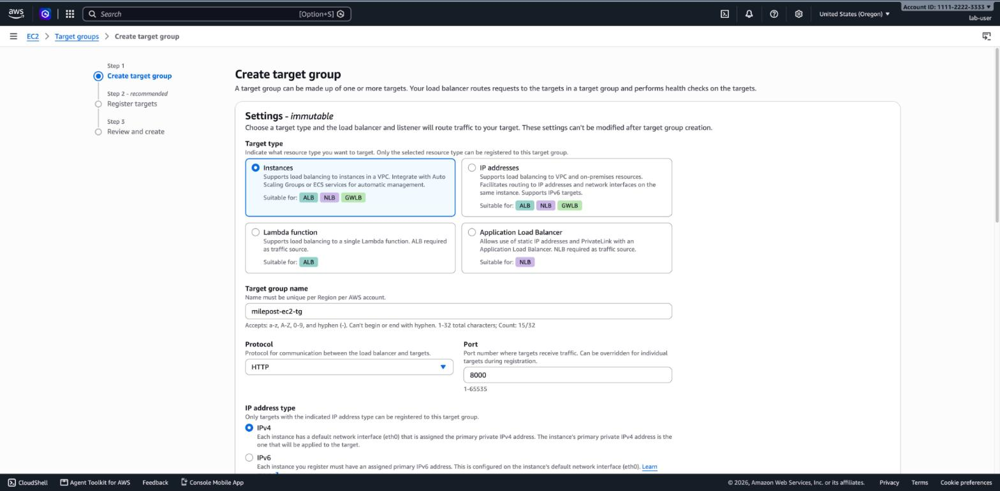

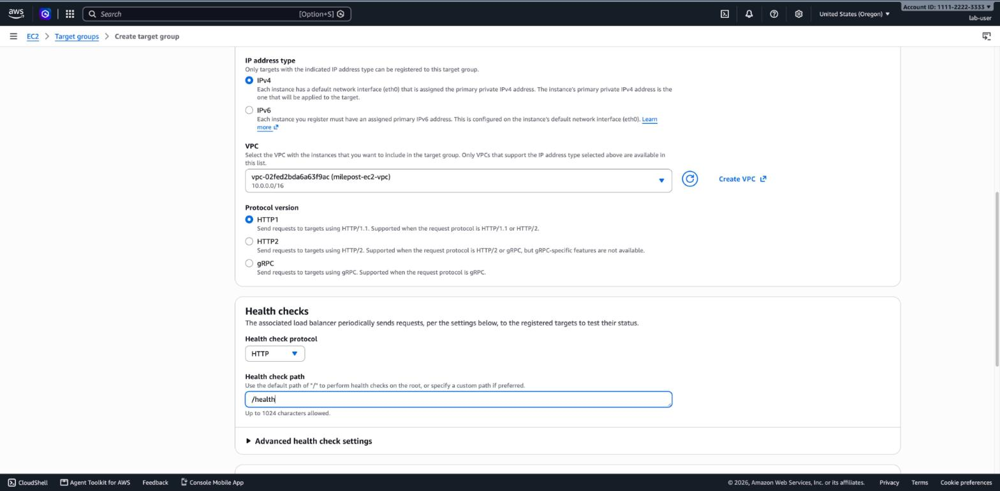

- **Next** → tick both instances → port **8000** → **Include as pending below** → **Create target group**.

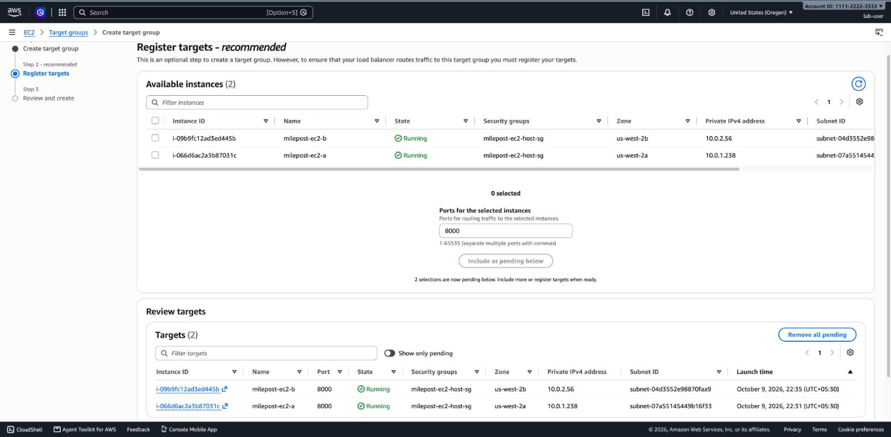

- `/health` makes the service score a test car and buyer. An instance whose models fail to load gets taken out, not just one whose port is closed.

### 12.3 Application Load Balancer

- **EC2 → Load balancers → Create load balancer → Application Load Balancer**

| Setting | Value |
|---|---|
| Load balancer name | `milepost-ec2-alb` |
| Scheme | Internet-facing |
| IP address type | IPv4 |
| VPC | `milepost-ec2-vpc` |
| Availability Zones and subnets | `us-west-2a` → `milepost-ec2-public-a`, `us-west-2b` → `milepost-ec2-public-b` |
| Security groups | `milepost-ec2-alb-sg` only (remove `default`) |
| Listener | HTTP 80 → Forward to `milepost-ec2-tg` |

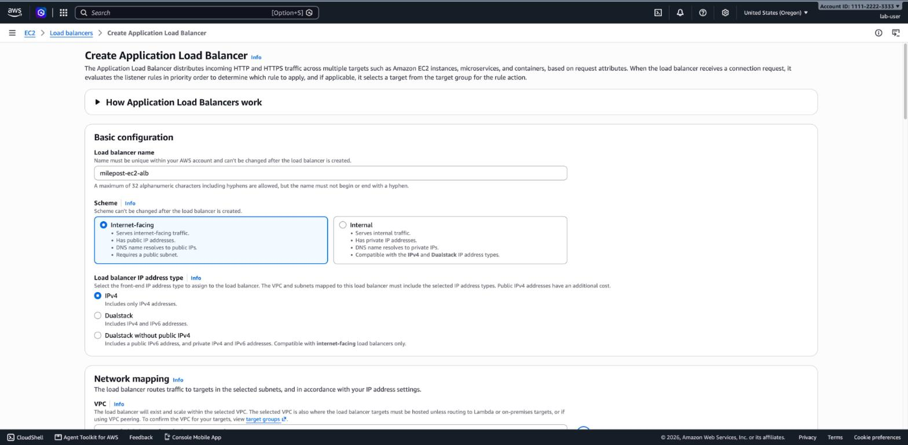

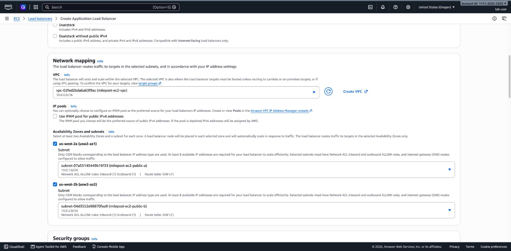

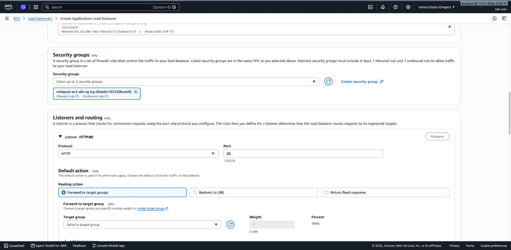

- **The console requires at least two AZs:** the load balancer places a node in each one, which is why the network has two subnets in two AZs.
- It also checks that each subnet's route table has an internet gateway route (`Route table: IGW ✓`).
- **Create load balancer**, then wait for state **Active** (a few minutes).

### 12.4 Only the load balancer may reach the instances

- Edit `milepost-ec2-host-sg` → inbound rule port 8000: change the source to the security group `milepost-ec2-alb-sg`, and remove the **My IP** rule.
- From now on, the only way in is through the load balancer.

### 12.5 Test it (expected results; not run in the screenshot account)

- Copy the load balancer's **DNS name** from its details page.

```bash
for i in $(seq 1 10); do curl -s http://<alb-dns-name>/; echo; done
```

- **Expected:** answers alternate between `us-west-2a` and `us-west-2b`, all from one address.
- **Repeat the stop experiment:**
  - stop `milepost-ec2-a`;
  - after a few failed health checks, the target group shows it as unhealthy or unused;
  - every request then goes to `milepost-ec2-b`, and the URL never changes.
- **Still true with the load balancer:** nothing replaces the stopped instance. Replacing failed machines is a separate feature, an EC2 Auto Scaling group.

## 13. Troubleshooting

| Symptom | Cause | Fix |
|---|---|---|
| `curl` to port 8000 times out, but worked earlier | Your public IP changed; the **My IP** rule still holds the old one | `curl https://checkip.amazonaws.com` shows your address. Edit the inbound rule → source type **My IP** again → **Save rules** |
| No answer in the first minutes after launch | User data is still installing Docker and pulling the image | Wait 2–3 minutes. To see progress: **Connect → Session Manager**, then `sudo tail -n 50 /var/log/milepost-bootstrap.log` |
| `exec format error` in the container's logs | The image was built for arm64 | Rebuild with `--platform linux/amd64`, push again, relaunch |
| User data log: `no basic auth credentials` or `AccessDenied` from ECR | No instance profile, or the wrong one | Attach `MilepostEc2Role` (**Actions → Security → Modify IAM role**), then relaunch the instance |
| `docker build` stops at `pip install` with `Could not find a version… (from versions: none)` | pip timed out reaching PyPI from inside Docker | Run the build again; on a slow connection add `--timeout 100` to the `pip install` line |
| Browser shows a warning page for `http://IP:8000` | Plain HTTP, no certificate | Continue past the warning, or use `curl` |
| Launch fails with a message about the instance type | The account allows only certain types | Use `t3.micro` |

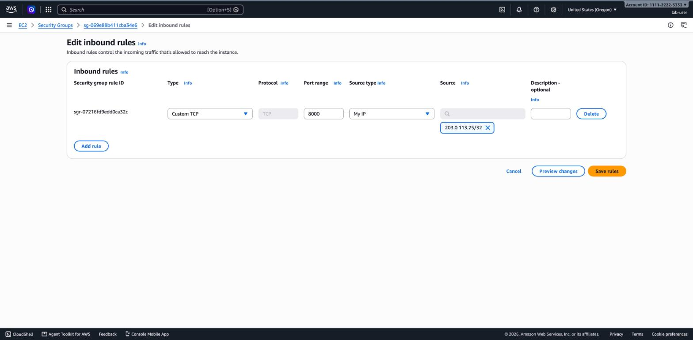

## 14. Clean up

**A stopped instance still bills for its disk and any Elastic IP; delete everything in this order.**

1. **Load balancer, if you created one:** delete `milepost-ec2-alb`, then the target group `milepost-ec2-tg`.
2. **Instances:** select both → **Instance state → Terminate (delete) instance**. Their root disks are deleted with them.

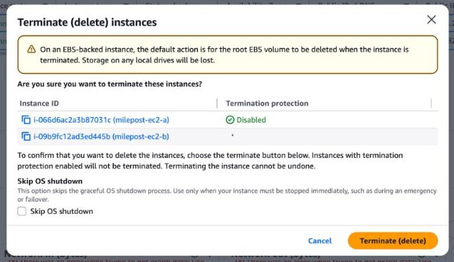

3. **VPC:** **VPC → Your VPCs → `milepost-ec2-vpc` → Actions → Delete VPC** → type `delete`. The dialog lists everything that goes with the VPC: the internet gateway, the route table, both security groups and both subnets.

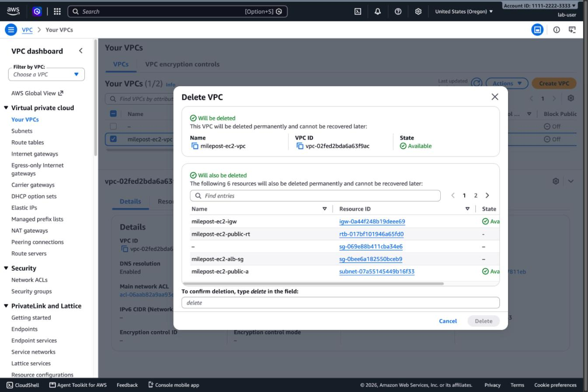

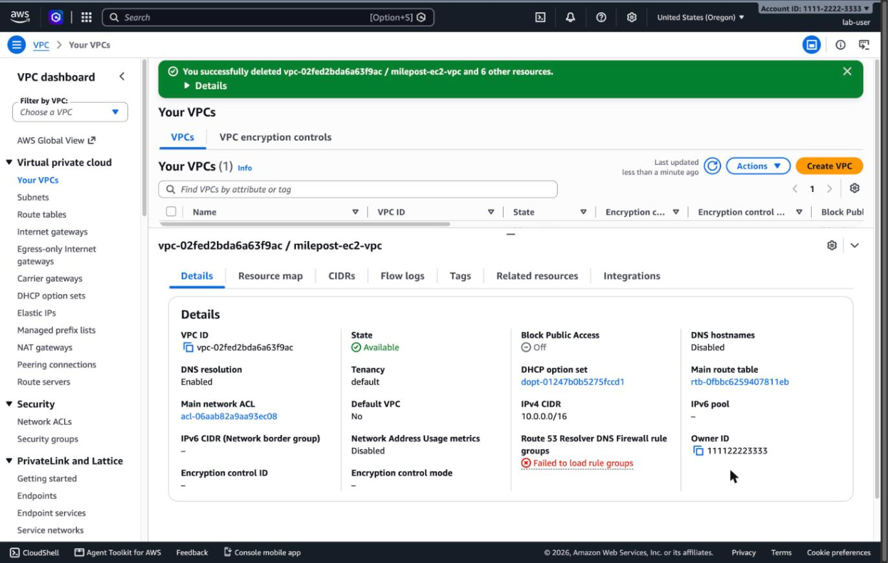

4. **ECR:** **Repositories → `milepost-ec2` → Delete** → type `delete`. This deletes the images inside it too.

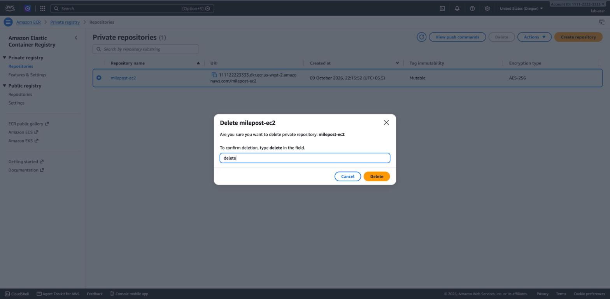

5. **IAM:** **Roles → `MilepostEc2Role` → Delete**. Some managed accounts deny role deletion. Then the role stays, unused: only EC2 can take it on, and no instance has it.
6. **Laptop:**
   - `docker rmi milepost-ec2:v1 $REGISTRY/milepost-ec2:v1`
   - `docker logout $REGISTRY`

- **Check that nothing is left.** Empty output means clean:

```bash
aws ec2 describe-instances --filters Name=instance-state-name,Values=pending,running,stopping,stopped \
  --query 'Reservations[].Instances[].InstanceId' --output text
aws ec2 describe-vpcs --filters Name=is-default,Values=false --query 'Vpcs[].VpcId' --output text
aws ec2 describe-volumes --query 'Volumes[].VolumeId' --output text
aws ecr describe-repositories --query 'repositories[].repositoryName' --output text
```

## 15. Reference

### Names used

| Resource | Name |
|---|---|
| VPC | `milepost-ec2-vpc`, `10.0.0.0/16` |
| Subnets | `milepost-ec2-public-a` (`us-west-2a`, `10.0.1.0/24`), `milepost-ec2-public-b` (`us-west-2b`, `10.0.2.0/24`) |
| Internet gateway | `milepost-ec2-igw` |
| Route table | `milepost-ec2-public-rt` |
| Security groups | `milepost-ec2-host-sg` (instances), `milepost-ec2-alb-sg` (load balancer) |
| ECR repository | `milepost-ec2`, tag `v1` |
| IAM role and instance profile | `MilepostEc2Role` |
| Instances | `milepost-ec2-a`, `milepost-ec2-b` |
| Target group / load balancer | `milepost-ec2-tg` / `milepost-ec2-alb` |

### Costs (us-west-2 on-demand list prices)

| Item | Price |
|---|---|
| `t3.micro` | $0.0104 per hour each |
| Public IPv4 address | $0.005 per hour each |
| 8 GiB gp3 disk | about $0.64 per month each, billed even while stopped |
| ECR storage | $0.10 per GB-month (the 165 MB image: about $0.02 per month) |
| Load balancer, if created | $0.0225 per hour plus usage (LCU) |

- Both instances running cost about **$0.03 per hour, roughly $0.75 per day**. Cleaning up ends all of it.
